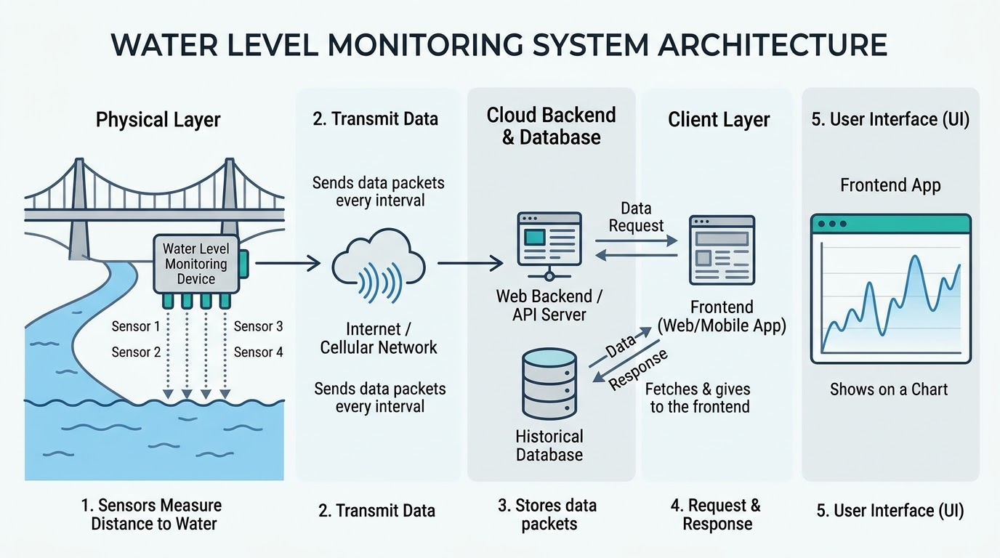
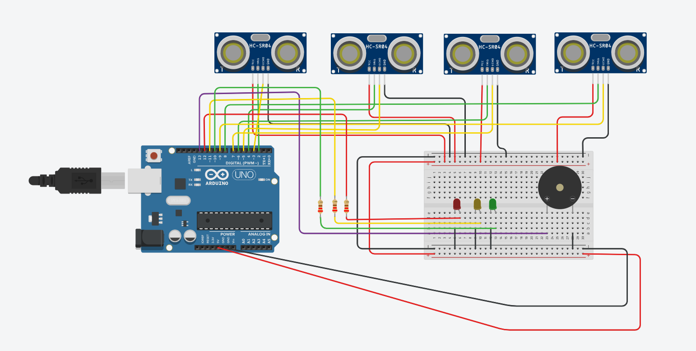
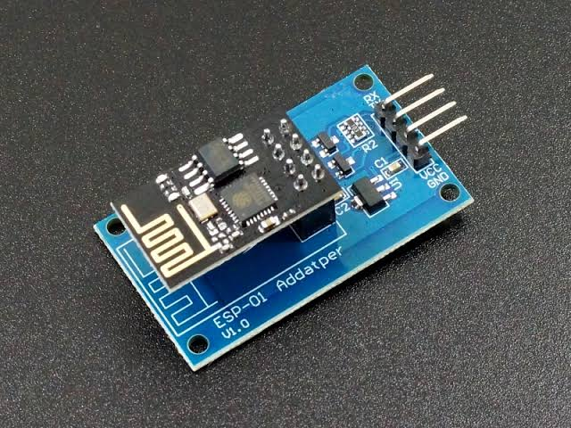

## SURGE - Real-Time Flood Warning System 🌊

An end-to-end IoT and Web solution engineered to bridge remote river level monitoring sensors directly to an interactive, real-time web dashboard.

The system continuously measures water clearance height at river locations using arrayed ultrasonic sensors, transmits telemetry payloads over Wi-Fi, stores historical time-series data, and visualizes real-time threat levels with interactive geographic maps and graphs.

## System Overview

## Hardware Wiring Diagram

Connect ESP 8266 WiFi module to above configuration, according to following table.

We use ESP 8266 WiFi module with a adapter.

| **Hardware Pin** | **ESP-01 Adapter Pin**   | 
| ---------------- | ------------------ | 
| 5V      | VCC | 
| GND      | GND | 
| Pin 19 (RX1)      | TX     | 
| Pin 18 (TX1)      | RX |
